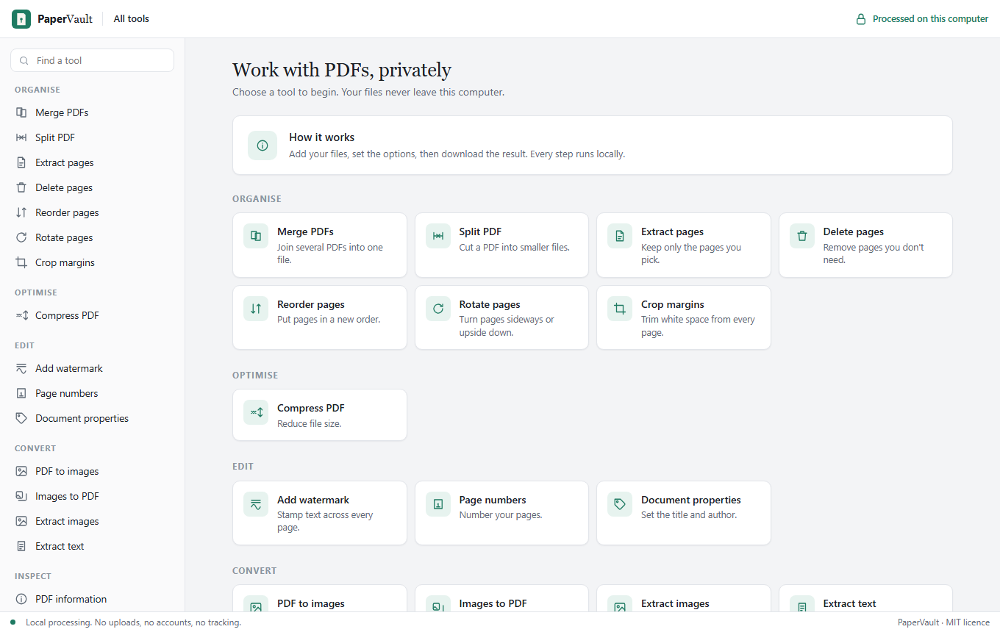

<p align="center">
  
</p>

<h3 align="center">Private PDF tools that run entirely on your computer.</h3>

<p align="center">
  
</p>


PaperVault merges, splits, rotates, compresses, watermarks and converts PDFs. It has a simple browser UI and a command line for scripts and AI assistants. Your files are never uploaded: PaperVault has no network code, no accounts and no analytics.

Website: https://rahuling.github.io/papervault/

## Features

| Area | Tools |
|---|---|
| Organize | Merge, split, extract pages, delete pages, reorder pages, rotate, crop margins |
| Optimize | Compress (downscales embedded photos) |
| Edit | Watermark, page numbers / headers / footers, edit title and author |
| Convert | Images to PDF, PDF to images (PNG/JPG), PDF to text, extract embedded images |
| Inspect | PDF info (pages, metadata) |

Not in this release: password protection (protect and unlock), OCR, PDF to Word/Excel, Office to PDF, e-signatures, redaction and PDF/A. Encryption is planned next.

## Contribute

PaperVault is open source and welcomes help: code, testing on macOS or Linux, design, and bug reports from real PDFs. Start with [CONTRIBUTING.md](CONTRIBUTING.md).

## Install

You need Rust 1.85 or newer (edition 2024).

```bash
git clone https://github.com/rahuling/papervault
cd papervault
cargo install --path .
```

This installs a `papervault` command. To build without installing, use `cargo build --release`; the binary is in `target/release/`.

**PDF to images** needs Poppler's `pdftoppm` on your PATH:
- Windows: download a build from https://github.com/oschwartz10612/poppler-windows/releases
- macOS: `brew install poppler`
- Linux: `sudo apt install poppler-utils` (or your distro's equivalent)

Every other tool works without extra software.

## Use the browser UI

```bash
papervault serve
```

This opens PaperVault at `http://127.0.0.1:8844`. The server listens only on your own machine, not on your network.

## Use the command line

```bash
papervault tools                                   # list tools and options
papervault run merge a.pdf b.pdf -o out/           # merge
papervault run split big.pdf -p every=10 -o parts/ # split every 10 pages
papervault run extract report.pdf -p 1,4-6 -o out/ # keep pages 1, 4, 5, 6
papervault run compress scan.pdf -p quality=60 -o out/
papervault run watermark draft.pdf -p text=DRAFT -o out/
papervault run to-text invoice.pdf -o out/
papervault run images-to-pdf *.jpg -p page_size=a4 -o out/
```

Add `--json` before the command for machine-readable output:

```bash
papervault --json run merge a.pdf b.pdf -o out/
# {"ok":true,"tool":"merge","outputs":["out/merged.pdf"]}
```

Page numbers are 1-based. Ranges look like `1-3,5,8-` (`8-` means "to the end"). Results are written to the output folder and never overwrite existing files.

## Use PaperVault from an AI assistant

The `skills/papervault/SKILL.md` file describes the CLI for AI assistants that support skills. Copy the folder into your assistant's skills directory. The skill tells the assistant to use `papervault tools --json` to discover options and `--json` output to read results.

## Privacy

- No network calls. The UI is a single file with no external scripts, fonts or images.
- The web server binds to `127.0.0.1` and rejects requests whose Host header is not local, which blocks DNS-rebinding attacks from web pages you visit.
- Temporary files (used by PDF to images) are deleted after each run.

## Development

```bash
cargo test                  # integration tests (generates its own PDFs and images)
cargo run -- serve          # run the UI from source
```

Layout:

- `src/pdf.rs`: merge, split, arrange pages, rotate, crop, metadata, text
- `src/images.rs`: images to PDF, compression, image extraction
- `src/stamp.rs`: watermark and page numbers
- `src/external.rs`: PDF to images via Poppler
- `src/tools.rs`: the tool registry shared by the CLI and the UI
- `src/web.rs`, `web/index.html`: the local browser UI
- `docs/`: the public website (GitHub Pages)

## Platforms

CI builds and runs the full test suite on Windows, Linux (x86_64) and macOS (Apple Silicon) on every push. macOS Intel is not built at the moment.

## License

MIT. See [LICENSE](LICENSE).
